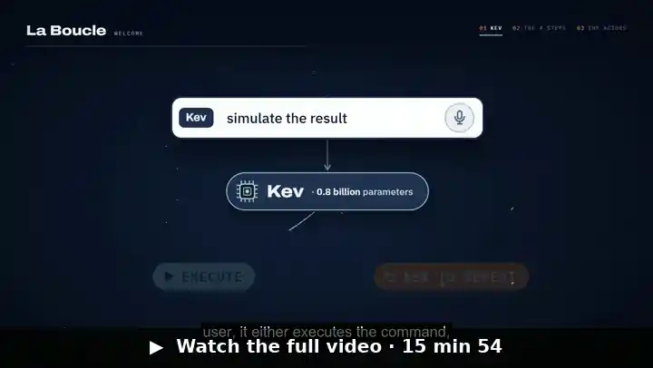
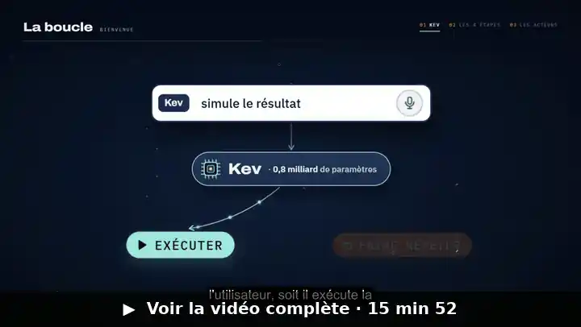
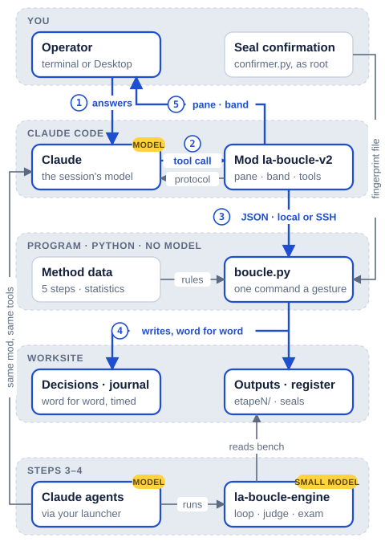
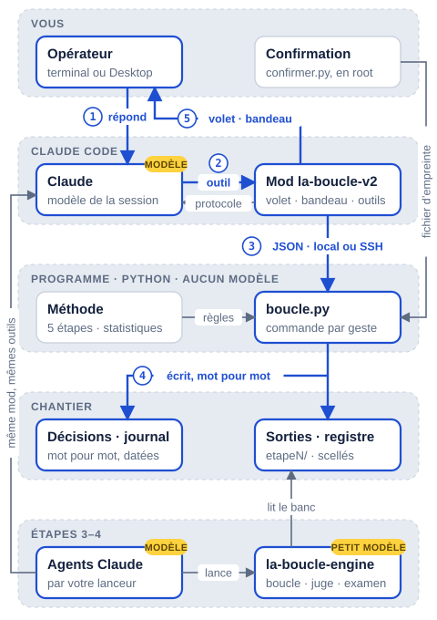

[English](README.md) · **Français**

# Module La boucle

**Un mod Claude Code qui fait d'une tâche métier un petit modèle local capable de la faire seul, vérifié sur des cas de test qu'aucun agent ne voit jamais.** Il guide en cinq étapes ; un programme, pas le modèle, tient le registre et fait les calculs.



*La méthode sur un cas réel : Kev, un agent local de 0,8 milliard de paramètres. La vidéo compte le banc et la boucle comme une seule étape.*

<details>
<summary>Version française de la vidéo</summary>



</details>

## Ce qu'on fait avec

- **Étapes.** Objectif, étude des données, banc, boucle, livrable.
- **Un chantier par session.** `/la-boucle-v2 <chantier>` rattache la session : un volet de contrôle à côté, un bandeau au-dessus de la saisie, les consignes de l'étape injectées.
- **Décisions mot pour mot.** Chaque décision est gardée avec les mots exacts de l'opérateur et son heure.
- **Des chiffres calculés.** Tailles d'échantillon, seuils et chance d'être reçu viennent de calculs binomiaux exacts.
- **Scellés.** Une étape n'est scellée que lorsque l'opérateur confirme son empreinte dans un fichier écrit par root (par défaut), que les agents ne peuvent pas écrire sans sudo.
- **Agents et boucle.** Les étapes 3 et 4 confient le travail à des agents Claude lancés par votre lanceur et à [`la-boucle-engine`](https://github.com/anthohunt/la-boucle-engine), dont le chercheur améliore le harnais (consignes, règles, code) autour du petit modèle.

## Architecture



*Flèches numérotées : une décision, dans l'ordre. Étiquettes jaunes : là où un modèle est appelé ; le programme n'en appelle aucun.*


<details>
<summary>Schémas en français</summary>




</details>

## L'essayer

```bash
git clone https://github.com/anthohunt/la-boucle-module && cd la-boucle-module
python3 exemples/demo.py               # deux chantiers inventés, sans modèle ni réseau
claude --plugin-dir .                  # puis : /la-boucle-v2 mon-chantier
```

Ou l'installer, dans Claude Code :

```text
/plugin install la-boucle-v2 --marketplace anthohunt/la-boucle-module
```

Il faut Claude Code 2.1.287 ou plus récent (mods) et Python 3.10 ou plus récent (bibliothèque standard seule). Installation, tests, organisation du dépôt : [`docs/install.md`](docs/install.md) (en anglais). Réglages : [`docs/settings.md`](docs/settings.md).

## État

- **Accès anticipé** (version 0.1.1). Sur un chantier réel, les étapes 1 et 2 sont scellées et l'étape 3 est en cours ; les étapes 3 à 5 sont par ailleurs couvertes par des tests sur des cas inventés.
- Le code, les textes à l'écran et les fichiers de méthode sont en français ; la documentation est en anglais.
- Code sous [Apache 2.0](LICENSE), textes sous [CC BY 4.0](LICENSE-docs). Rien n'est envoyé à l'auteur : [`docs/privacy.md`](docs/privacy.md).

---

**Anthony Hunt** · [ingevision.cloud](https://ingevision.cloud/?lang=fr&p=boucle) · [LinkedIn](https://www.linkedin.com/in/anthony-hunt-3948a9196) · [GitHub](https://github.com/anthohunt)
