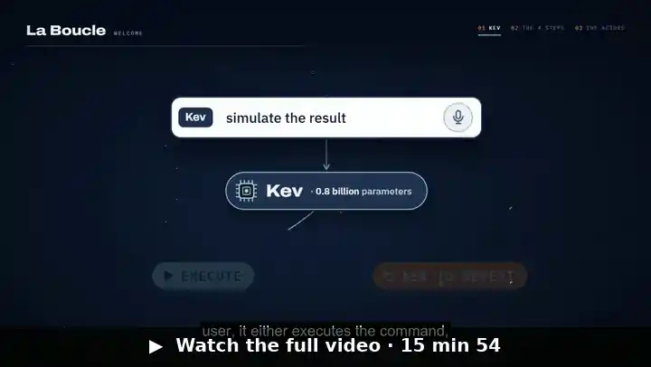
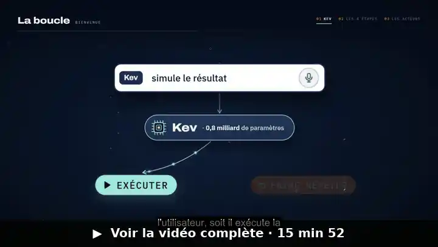
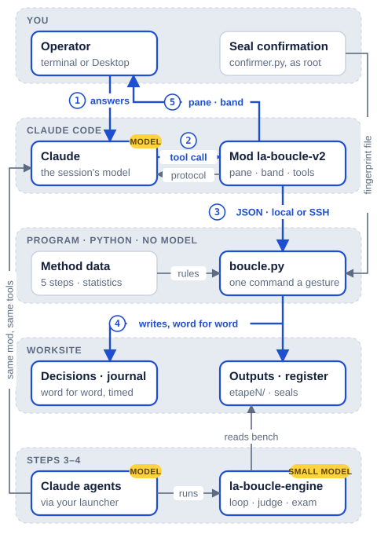
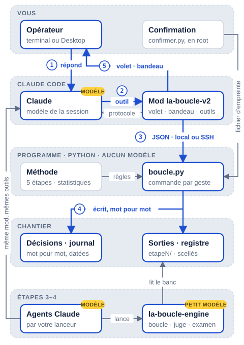
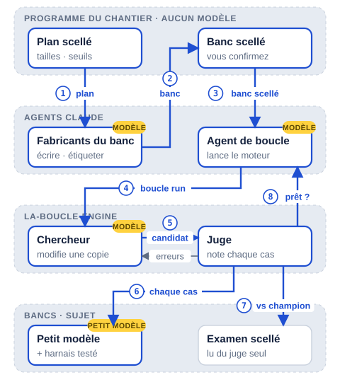

**English** · [Français](README.fr.md)

# La boucle module

**A Claude Code mod that takes a business need to a small model proved on a sealed exam, in five steps.** A program, not the model, keeps the state, computes the numbers and records every decision of the operator word for word.

[](https://drive.google.com/file/d/1B0ZIb4txHxiYe0JcUWBq3rJRpRpqhCxr/view)

*The method on a real case: Kev, a local agent of 0.8 billion parameters. [Full video (15:54)](https://drive.google.com/file/d/1B0ZIb4txHxiYe0JcUWBq3rJRpRpqhCxr/view). The video counts training as one step; the module splits it into the bench and the loop.*

<details>
<summary>Version française de la vidéo</summary>

[](https://drive.google.com/file/d/1TZXAxUeyCGkEj3yFR7hDBZXeerJQxmtA/view)

*[Vidéo complète (15:52)](https://drive.google.com/file/d/1TZXAxUeyCGkEj3yFR7hDBZXeerJQxmtA/view)*
</details>

## Using it

- **Five steps.** The objective, the data study, the bench, the loop, the deliverable.
- **One worksite per session.** `/la-boucle-v2 <worksite>` attaches the session: a control pane on the side, a band above the prompt, the step's instructions injected.
- **Decisions word for word.** Each decision is stored with the operator's exact words and its time.
- **Numbers from a program.** Sample sizes, thresholds and the chance of passing come from exact binomial computations.
- **Seals agents cannot forge.** A step is sealed only when the operator confirms its fingerprint in a file that only root writes (by default), out of the agents' reach.
- **Agents and loop.** Steps 3 and 4 hand the work to Claude agents started by your launcher and to [`la-boucle-engine`](https://github.com/anthohunt/la-boucle-engine).

## Architecture



*Numbered arrows: one decision, in order. Yellow tags: where a model is called; the program calls none.*


<details>
<summary>Schémas en français</summary>




</details>

## Try it

```bash
git clone https://github.com/anthohunt/la-boucle-module && cd la-boucle-module
python3 exemples/demo.py               # two invented worksites, no model, no network
claude --plugin-dir .                  # then: /la-boucle-v2 my-worksite
```

Or install it, inside Claude Code: `/plugin install la-boucle-v2 --marketplace anthohunt/la-boucle-module`.

Needs Claude Code 2.1.287 or later (mods) and Python 3.10 or later (standard library only). Installing, tests, layout: [`docs/install.md`](docs/install.md). Settings: [`docs/settings.md`](docs/settings.md).

## State

- **Early access** (version 0.1.1). On a real worksite, steps 1 and 2 are sealed and step 3 is under way; steps 3 to 5 are otherwise covered by tests on invented cases.
- Code, on-screen text and method files are in French; the documentation is in English.
- Code under [Apache 2.0](LICENSE), texts under [CC BY 4.0](LICENSE-docs). Nothing is sent to the author: [`docs/privacy.md`](docs/privacy.md).

---

**Anthony Hunt** · [ingevision.cloud](https://ingevision.cloud/?lang=en&p=boucle) · [LinkedIn](https://www.linkedin.com/in/anthony-hunt-3948a9196) · [GitHub](https://github.com/anthohunt)
